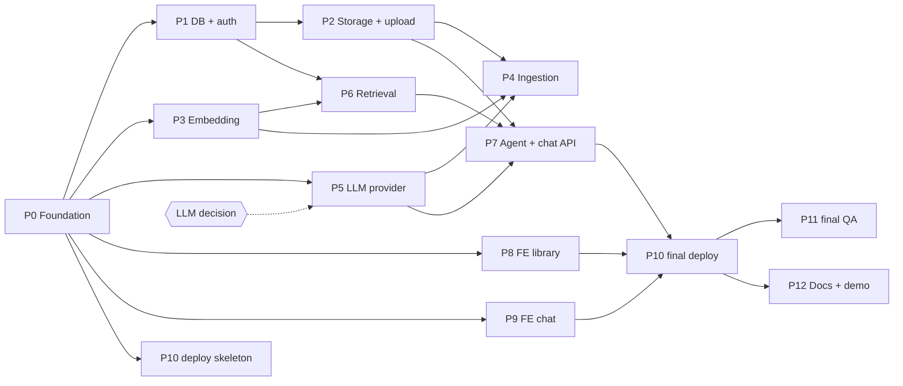

# Build plan

The work is split into **parts** (P0–P12). Each part has a fixed start (what must exist first) and a fixed end (what must be true when it's done). Each part has its own brief in [`docs/parts/`](parts/). The design is in [ARCHITECTURE.md](ARCHITECTURE.md). The live status of every part is in [../HANDOFF.md](../HANDOFF.md).

## Parts

| Part | Name | Starts after | Done when |
|---|---|---|---|
| [P0](parts/P0-foundation.md) | Foundation + shared contract | nothing | `npm run dev` runs client and server; `shared/` exports every API and SSE schema; `/api/health` returns 204 |
| [P1](parts/P1-db-auth-collections.md) | Database, auth, collections | P0 | Migrations run on Neon; register/login/me and collections CRUD pass tests |
| [P2](parts/P2-storage-upload.md) | R2 storage + upload API | P1 | A file goes browser → R2 via signed URL, `/complete` checks it and queues a job; delete removes R2 objects |
| [P3](parts/P3-embedding-client.md) | Embedding client + limits spike | P0 | One vector per modality from `gemini-embedding-2`; real limits written to DECISIONS.md |
| [P4](parts/P4-ingestion.md) | Ingestion worker | P2, P3, P5 (fake is enough) | PDF, image, audio, video and DOCX all reach `ready` with correct chunks in Neon |
| [P5](parts/P5-llm-provider.md) | LLM provider layer | P0 (real adapter waits for the LLM decision) | `FakeProvider` + real adapter pass the same contract tests; capability table filled |
| [P6](parts/P6-retrieval.md) | Hybrid retrieval | P1, P3 | Search by text and by image returns correct ranked chunks with filters |
| [P7](parts/P7-agent-chat-api.md) | Agent loop + chat API | P2, P5, P6 | A question streams reasoning, tool calls, a cited answer and sources over SSE, and is saved |
| [P8](parts/P8-frontend-library.md) | Frontend: auth, collections, upload | P0 | Login, collections grid, upload with live status work against mocks, then the real API |
| [P9](parts/P9-frontend-chat.md) | Frontend: chat | P0 (+ P8 shell) | Chat streams from a recorded fixture, then the real API; all four source viewers work |
| [P10](parts/P10-deploy-ops.md) | Deploy + ops | P0 (skeleton), final pass after P7–P9 | Live URL works from a fresh account; keep-alive pings every 10 min |
| [P11](parts/P11-review-qa.md) | Review, security, E2E | each part's PR; final pass after P10 | Every part reviewed by an agent other than its author; E2E script passes on the live site |
| [P12](parts/P12-docs-demo.md) | README + demo | P10 | README, demo library, demo script, 3–5 min video |

## Dependency graph

## Lanes (what can run at the same time)

After P0 merges, four lanes can run in parallel, each in its own git worktree:

| Lane | Parts, in order |
|---|---|
| Backend core | P1 → P2 |
| AI | P3 and P5 (fake first) → P6 |
| Ingestion | P4 (starts when P2, P3, P5-fake are in `main`) |
| Frontend | P8 → P9 (mocks first, real API when ready) |

Who works on which part is decided by the user when the part starts, and recorded in HANDOFF.md.

Then P7 joins the backend and AI lanes, P10 deploys, and P11/P12 close out.

## Blocked on a decision

| Decision | Blocks | Not blocked |
|---|---|---|
| Which LLM (and whether a separate describe model is needed) | P5 real adapter, then real describe in P4 and real answers in P7 | Everything else. P4 and P7 are built and tested with `FakeProvider`. |
| Gemini key limits (check in AI Studio) | Size of the demo library (P12) and `EMBED_RPM` | Everything else |

## Rules for every part

- Read [HANDOFF.md](../HANDOFF.md) first. Update it last.
- One branch + worktree per part: `part/p<N>-<slug>`. PR into `main`.
- A part is done only when every item in its "Done when" list is checked and an agent other than its author has reviewed the PR (P11).
- Contract changes (`shared/`) go in their own small PR, merged before the code that uses them.
- New decisions go in [DECISIONS.md](DECISIONS.md) the moment they're made.
